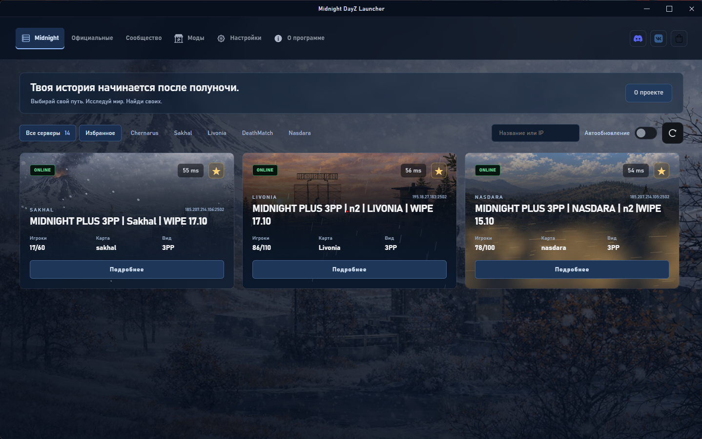

# Unofficial Midnight DayZ Launcher

Неофициальный лаунчер для удобного подключения к серверам Midnight DayZ. Показывает состояние серверов, помогает проверить и загрузить необходимые моды через Steam и запускает DayZ через BattlEye.

**Это самостоятельный проект Tidmid2, а не официальный продукт администрации Midnight, Bohemia Interactive, Valve или Discord.** Названия и изображения используются для обозначения соответствующих проектов; их присутствие не означает одобрения или партнёрства.

## Зачем он нужен

Чтобы выбрать сервер, увидеть онлайн, ping и очередь, проверить моды и перейти к игре из одного приложения. Отдельно доступны официальные серверы DayZ и серверы сообщества, которые можно добавить вручную.

## Возможности

- Серверы Midnight с поиском по названию и IP, разделением по картам и избранным.
- Статус сервера, количество игроков, очередь при наличии данных, ping, версия игры и перспектива камеры.
- Официальный список DayZ через Steam и ручное добавление серверов сообщества.
- Фильтры по карте, камере, заполненности, ping и доступности сервера.
- Автоматическая проверка модов перед входом на сервер: недостающие и устаревшие моды загружаются через Steam до запуска игры.
- Управление установленными модами: обновление, повторная загрузка и удаление.
- Очистка накопившихся логов и дампов DayZ из настроек лаунчера.
- Запуск через `DayZ_BE.exe` с BattlEye и параметрами выбранного сервера.
- Сохранение настроек, избранного и списка серверов сообщества на компьютере.
- Отдельное автообновление статусов для разделов: опрос выполняется, только когда окно активно.
- Погодные эффекты Midnight: снег на Sakhal, дождь на Livonia и песчаная пыль на Nasdara. Их можно отключить в настройках.
- Discord Rich Presence и обновления самого лаунчера с проверкой цифровой подписи пакета.

## Перед входом моды обновляются автоматически

Нажмите «Играть» — лаунчер проверит моды выбранного сервера через Steam и загрузит недостающие или устаревшие версии. Вручную обновлять каждый мод перед подключением не нужно. Во время проверки и загрузки отображается прогресс; операцию можно отменить.

Игра запускается после завершения проверки и готовности необходимых модов. Если загрузка не удалась или часть модов не готова, лаунчер покажет проблему и не продолжит запуск. Для сервера без модов проверка Workshop не требуется. Steam должен быть запущен; для загрузки нужен интернет.

## Полезные инструменты

### Очистка логов DayZ

В разделе «Настройки» есть кнопка очистки накопившихся логов и дампов игры. Она удаляет файлы `.log`, `.rpt` и `.mdmp` из `%LOCALAPPDATA%\DayZ` и его подпапок, показывает ход операции и количество удалённых файлов. Это помогает освободить место после длительной игры и вылетов.

Очистка запускается вручную. Она не выбирает файлы по возрасту: удаляются все найденные файлы этих трёх форматов, включая свежие. Настройки и профили других форматов не затрагиваются. Если логи нужны для разбора ошибки, сохраните их перед очисткой.

### Восстановление модов

В разделе «Моды» можно обновить отдельный мод, перекачать его при проблемах с файлами или удалить ненужный. Для исправления некорректных записей Workshop предусмотрено восстановление `appworkshop_221100.acf`: перед изменением создаётся резервная копия. Эти инструменты полезны, если Steam повторно качает моды или состояние Workshop не совпадает с установленными файлами.

### Меньше повторных действий

- **Избранное:** отмечайте серверы звёздочкой, чтобы быстро находить их снова.
- **Сохранение списков и фильтров:** переход между разделами не требует заново настраивать поиск и прокрутку.
- **Автообновление статусов:** отдельный переключатель для Midnight, официальных серверов и сообщества; опрос выполняется только при активном окне.
- **Автоопределение путей:** лаунчер помогает найти Steam, DayZ и Workshop; пути можно указать вручную.
- **Настройки запуска:** никнейм и дополнительные аргументы сохраняются для следующих подключений.
- **Погодные эффекты:** их можно отключить, если нужен более спокойный интерфейс или меньшая нагрузка.

## Данные и безопасность

Лаунчер не просит вводить логин, пароль или код подтверждения Steam и Discord. Для работы с игрой и Workshop используется уже запущенный клиент Steam; для Discord Rich Presence — локальный клиент Discord.

В текущих исходниках нет собственного механизма сбора паролей, cookies браузера или отправки личных файлов разработчику. Нет отдельной системы аналитики или отправки телеметрии разработчику. Это описание реализации, а не заявление о независимом аудите безопасности.

Что приложение использует:

| Данные или действие | Для чего нужны |
| --- | --- |
| Путь к DayZ и библиотекам Steam | Найти игру и установленные моды, подготовить запуск |
| Никнейм и параметры запуска | Передать выбранные параметры игре |
| Настройки, избранное и добавленные серверы | Сохранить ваш выбор локально |
| Ответы игровых серверов | Показать онлайн, ping, очередь и список модов |
| Steam / Steam Workshop | Получить сведения о серверах и модах, скачать или обновить моды |
| GitHub Releases | Проверить новую версию и скачать подписанное обновление |
| Discord Rich Presence | Показать активность лаунчера или выбранного сервера в Discord |

Настройки сохраняются в локальном каталоге данных приложения и хранилище WebView. Если вы сохраняете пароль игрового сервера, он также хранится локально; это **не пароль аккаунта Steam**. Локальное хранение не является шифрованным хранилищем секретов.

Лаунчер обращается к игровым серверам, сервисам Steam, GitHub и источникам изображений модов. Эти сервисы видят обычные сетевые данные подключения, включая IP. Функции установки, удаления и восстановления модов могут менять файлы Workshop и служебные данные Steam; это рабочие функции приложения.

## Установка и первый запуск

1. Скачайте установщик из [Releases этого репозитория](https://github.com/tidmid2/unofficial_midnight_launcher/releases).
2. Установите лаунчер и запустите Steam под своей учётной записью.
3. Убедитесь, что DayZ установлен. При необходимости укажите путь к игре в настройках лаунчера и задайте никнейм.
4. Выберите сервер и нажмите «Играть». Лаунчер автоматически проверит и при необходимости обновит его моды через Steam, затем запустит игру.

Нужны Windows 10/11 x64, Steam, приобретённая DayZ и Microsoft Edge WebView2. Для карт из платных дополнений требуется соответствующий DLC. Лаунчер не заменяет покупку игры и не обходит Steam, BattlEye, блокировки или правила серверов.

## Обновления

Лаунчер проверяет новые версии через `latest.json` в GitHub Releases. Перед установкой скачанный пакет проверяется публичным ключом, встроенным в приложение. Подпись подтверждает соответствие пакета ключу проекта; она не означает, что приложение официально одобрено Midnight или Bohemia Interactive.

## Обратная связь и авторство

Об ошибках можно сообщить в [Issues](https://github.com/tidmid2/unofficial_midnight_launcher/issues). Приложите описание, версию лаунчера и скриншот. Перед публикацией логов уберите личные данные, пароли серверов и другие секреты.

DayZ и связанные товарные знаки принадлежат их правообладателям. Логотипы и изображения сторонних проектов не становятся собственностью автора лаунчера.

**Created By Tidmid2**
